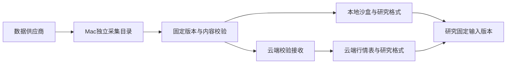

# 数据同步与研究就绪整改报告

> 验收时间：2026-09-27，北京时间。本文在真实采集与两端应用结束后更新最终状态。

## 结论

当前瓶颈不是“必须先把Tushare全部采完才能研究”，而是采集范围、数据所有权和研究验收阶段混在了一起。日频研究已有可复用基础；后续应先固定与课题匹配、经过验证的数据版本，不能让全站历史、附件和海外权限问题阻塞所有研究。

本次把日常市场采集统一移到Mac：QuantDB、Tushare、BTC/ETH均由本地取数；云端接收校验版本、生成研究格式和提供业务服务。云端业务数据库仍留在云端，本地沙盒数据库没有回灌。

## 为什么之前持续卡住

1. **约定与实现不一致。** Tushare已经本地采集，但QuantDB 03:00和BTC/ETH 08:15仍由云端采集；此前“已本地化”的说法只适用于Tushare。
2. **采集面太宽。** Tushare约31个家族大范围运行，公告/附件待下载队列超过1,331万条。关闭规划开关仍可能从历史积压继续派发，因此仅调优任务优先级不够。
3. **不同阶段被当作同一件事。** 采集成功、发布版本、云端可读、PG/Qlib/H5可用、某个研究实际使用，是五个不同结论；安装定时器和下载成功均不能替代末端验收。
4. **首次接管需要核对历史。** QuantDB重建本地采集检查点时，发现后复权、指数及部分衍生数据的历史文件与供应商清单不同；仅比较最新日期会遗漏。首次接管进行内容核验和差异补传，后续复用检查点。
5. **存储增长缺少用途约束。** 原始响应、文档、发布清单、沙盒备份和派生缓存同时增长；目录逻辑大小又混有APFS克隆，不能直接相加当作真实占盘或可回收量。

## 新的链路

云端离线接收失败、Mac休眠和本地研究繁忙都有单独的待恢复状态；使用最后一个通过验收的版本，不在云端回退采集。

## 哪些每天更新

| 数据 | 唯一采集端与频率 | 当前自动范围 | 研究用途 |
| --- | --- | --- | --- |
| QuantDB | Mac每日03:00，15分钟补查与唤醒补跑 | 现有23个股票/指数日线、因子、财务及基础数据集 | PG行情查询、Qlib日频研究、市场分析；继续作为已有研究基础 |
| Tushare | Mac原生worker每5分钟有限批次，研究版每小时发布；云端约15分钟拉取 | 18个接口，详见下表 | ETF/行业/成分与交易约束补充、源数据核验；按固定release读取 |
| Binance | Mac每日08:15，15分钟补查与唤醒补跑 | BTCUSDT、ETHUSDT的已收盘UTC日线 | 生成Qlib/H5，保持原始成交额和版本关联 |

**QuantDB 23个数据集：**

- 行情：daily_unadjusted、daily_forward、daily_backward、index_daily。
- 衍生：margin_trading、valuation、technical_indicators、market_sentiment、features_daily、l1_factors、l2_factors、l1_l2_factors。
- 基础与财务：sector_concept、instrument_detail、index_weights、trading_calendar、balance、income、cashflow、capital、pershare_index、dividend_factors、holder_num。

“每天检查更新”不表示每个数据集每天都会新增记录。融资融券、财报和成分数据按各自供应商可用日验收。

## 重点与非重点

| 优先级 | 数据 | 本次处理 |
| --- | --- | --- |
| P0：研究基础 | daily、adj_factor、daily_basic、stk_limit、suspend_d、stock_basic、index_basic、index_daily、trade_cal、fund_basic、fund_daily、fund_adj | 保留Tushare自动采集和研究发布；配合QuantDB已有基础 |
| P1：课题补充 | index_weight、ci_daily、sw_daily、index_classify、index_member_all、moneyflow | 保留有限批次采集；历史覆盖、成分时点另按课题验收 |
| P2：当前非必需 | Tushare公告/PDF/文本、广泛财务补采、海外/期货/分钟等其他接口 | 暂停自动采集与旧积压派发，保留原始文件和检查点 |
| 按需 | ETF持仓、其他币种、股票代币/永续、新市场、分钟/Tick | 没有自动扩池；有具体研究需求再增加 |

QuantDB分钟线、Tick、旧 `4_bond_etf/etf_kline` 不属于现有23项日更；审计时这些旧数据停在9月3日。AAPLB及另16项Binance扩充批次保留固定版本，本次没有改为每日采集。US/HK/FUTURES日更未开启。Tushare权限受限接口保持明确缺口，暂停不等于补齐。

## 实际修复

- 新增本地采集编排，复用现有供应商采集器、固定清单校验、增量传输和PG/Qlib/H5构建器。
- 云端五市场采集调度均关闭；云端角色在调度、手动入口及供应商客户端处拒绝重新采集。页面改为显示本地来源和云端接收日期。
- Tushare添加真正的自动采集白名单，禁止被保留的非重点积压绕过配置；发布范围从15项扩到18项，兼容旧版本指针并保留旧版本。
- QuantDB修复V1检查点重建误用前一个V2发布游标的问题。
- 传输清单和文件逐项核验；云端目录切换带恢复日志，已应用版本幂等；中断续传不会覆盖用于恢复的旧目录。
- 新产生的中转版本和该编排登记的A股回滚副本保留最近两版；迁移前旧备份与研究固定输入保留。
- 原生配置有维护备份；共享服务仅更新相关API/市场worker，独立R01研究容器保持运行。

## 真实验收

最终状态与证据待本轮采集、应用结束后填入。验收分别记录采集端、发布ID、两端数据日期、派生结果和真实读取结果。

## 空间判断

整改前审计：Mac约788GiB可用，近一天整盘净下降约122GiB；这包含其他工作负载，不能全归因于Tushare。按原速度持续会很快触及预警，所以重点是先减少无关采集和重复版本增长。

- 原生Tushare维持500GiB预警、300GiB停采保留线；新的本地行情采集同样保留300GiB。
- 云端接收保留100GiB恢复空间；Tushare研究缓存预算50GiB。
- 已暂停公告附件及广泛补采，降低发布频率，并限制新中转/回滚副本数量。
- 本轮不把APFS克隆的逻辑大小当作可释放空间；既有备份、原始归档和固定研究数据未批量删除。

整改后的增长速度需要跨至少一个日更周期观测，不能凭当下空闲量宣称存储压力已消失。当前无需为了恢复研究立即扩容；持续全历史归档仍适合后续迁移NAS。

## 研究如何继续

已经验收的QuantDB/既有冻结输入可继续服务日频研究；Tushare负责补充当前课题真正需要的字段，不再作为所有研究共同等待的全量工程。

新课题开跑前只核验自己的数据合同：标的/日期覆盖、复权和成交额口径、停牌涨跌停、成分与财务可用时点、成本和执行时序。Tushare `history_complete=false`、历史回填缺少PIT证明、部分权限限制仍然成立；这些限制影响相应研究方法，不能用日更成功消除。

本轮数据接入没有启动策略研究、调参、虚拟盘或实盘；后续仍遵守最近半年保留验证规则。完整数据库快照仍用于恢复，独立于每日市场采集。

运行、失败恢复、保留范围与手动入口见 [本地数据源运行说明](local-market-source.md)。
